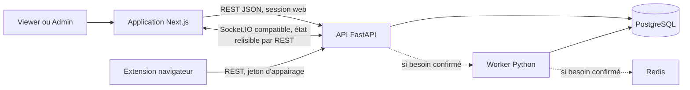

# Architecture cible de Skkup V2

## Statut et niveau de preuve

Ce document traduit le cahier accepté et les décisions publiques du projet en une
architecture de cadrage. Il ne décrit pas un système déjà implémenté.

- **Décisions consignées :** FastAPI, Pydantic, SQLAlchemy 2, PostgreSQL,
  Next.js/React/TypeScript et Docker. Le dépôt public existe déjà.
- **Préservation d’interface :** vitrine, Connexion/Inscription et popup gardent
  leur rendu V1; les dashboards Viewer/Admin sont reconstruits.
- **Suivi :** GitHub Projects souhaité, Trello désactivé; la synchronisation
  distante reste `pending_activation`.
- **Baseline conditionnelle :** compatibilité avec le protocole Socket.IO du
  client existant; Redis et worker uniquement si un besoin est confirmé.
- **Non vérifié dans cette passe :** routes, payloads, événements, modules,
  règles métier et dépendances exactes de la V1. Les chemins cités par le cahier
  sont des sources à examiner, pas une preuve d’implémentation actuelle.
- **À décider ultérieurement :** versions verrouillées, hébergement, fournisseur
  de secrets et service email. Aucun changement de production n’est autorisé.

## Vue logique

PostgreSQL est la source de vérité de l’identité, des permissions, soldes,
sessions, achats, tickets et résultats. Le temps réel rafraîchit l’interface,
mais les clients doivent relire l’état par REST après une déconnexion. Le
diagramme représente une cible logique, pas la topologie de production.

## Composants et frontières

| Composant | Responsabilité | Statut et vérification |
|---|---|---|
| Next.js | Vitrine, authentification visuellement fidèle, dashboards Viewer/Admin | Stack décidée; routes V1 à inventorier |
| FastAPI | Règles métier, autorisation, validations et contrats REST JSON/OpenAPI | Stack décidée; chemins et comportements V1 à relever |
| Pydantic | Validation des entrées et formes de réponses | Baseline du cahier |
| SQLAlchemy 2 | Persistance et transactions métier | Décision de stack |
| Alembic | Migrations de schéma versionnées | Baseline du profil |
| PostgreSQL | Stockage durable, contraintes et source de vérité | Décision de stack; base V2 initialement vide |
| Extension WebExtension | Appairage et suivi éligible; popup conservé | Manifeste, permissions et scripts à inventorier |
| Worker Python | Tâches asynchrones si le besoin est démontré | Optionnel, aucun service choisi |
| Redis | File/pub-sub si une exigence le justifie | Optionnel, non activé par défaut |
| Docker Compose | Environnement local reproductible | Décision Docker; production non définie |

Le backend est un monolithe modulaire. Les domaines pressentis par le cahier
sont identité/session, profil, visites/points, watch sessions, extension,
récompenses/cartes, boutique, tirages/lots, annonces/contenu, administration,
anti-fraude et temps réel. Ce découpage reste à rapprocher des règles actives
avant le scaffold.

## Flux structurants

### Session web et autorisation

Le navigateur utilise le parcours d’authentification existant. Le serveur
valide le compte et contrôle Viewer/Admin à chaque endpoint. La session web
reste distincte du credential d’extension. Cookies, CSRF, CORS, expiration et
révocation suivent les contraintes du cahier; les routes exactes restent à
vérifier sur la référence.

### Appairage et visionnage

Le Viewer demande un code depuis le site, le saisit dans le popup, puis
l’extension obtient un credential distinct et révocable. L’extension envoie
les signaux de lecture; l’API calcule les durées éligibles et les règles
anti-fraude côté serveur. Le client ne décide ni du crédit ni de la source
d’authentification. Les chemins/payloads utilisés par la version distribuée
doivent rester compatibles ou être versionnés avec elle.

### Crédit, récompenses et achats

Le ledger de points, l’achat, son débit et l’attribution de code ou ticket
doivent être atomiques. Les unicités, clés d’idempotence et transactions
protègent contre retries, doubles soumissions et concurrence. Les résultats
sont lisibles par REST et, si activé, diffusés par Socket.IO.

### Administration

Les droits sont vérifiés par l’API. Le cahier impose une modale sur la route
Admin courante pour les créations d’entités. Les opérations sensibles et
changements de contenu sont audités. Le premier Admin est initialisé hors
interface par une procédure contrôlée et ponctuelle.

## API, événements et intégrations

- Publier OpenAPI depuis FastAPI et générer/vérifier les types TypeScript.
- Préserver le contrat HTTP consommé par l’extension jusqu’à son inventaire;
  toute rupture est versionnée et coordonnée.
- Garder la compatibilité Socket.IO comme baseline. Ne pas substituer un
  WebSocket natif en supposant les protocoles équivalents. Avant implémentation,
  relever noms d’événements, rooms, authentification et reconnexion de la V1.
- Le cahier cible Twitch, YouTube et Kick pour le visionnage. Facebook dans un
  ancien modèle n’en fait pas une plateforme V2 sans décision complémentaire.
- Aucun nouvel OAuth de plateforme n’est inclus. L’email attend le choix d’un
  fournisseur et d’un budget. Le déploiement cible reste à décider.

## Sécurité, données et résilience

- Séparer session web et jeton d’extension; stocker les empreintes des jetons
  révocables et ne jamais exposer hashes de mot de passe ou secrets.
- Injecter les secrets à l’exécution. Chiffrer les codes de récompense avec
  une clé externe au dépôt, selon le cahier.
- Protéger les mutations par cookie contre CSRF, limiter les entrées, tailles,
  pagination et routes sensibles; appliquer CORS strictement.
- Rendre atomiques les crédits, achats, tickets et résultats; protéger les
  retries et les courses par contraintes et transactions PostgreSQL.
- Les événements temps réel ne remplacent pas l’état durable. Les journaux
  restent structurés et ne contiennent pas de credentials ni de codes.
- Définir rétention, suppression/export, sauvegarde et restauration avant
  l’activation publique. Aucune donnée de production n’est lue dans ce travail.

## Exploitation et validation

- Docker Compose local démarre le frontend, l’API et PostgreSQL avec base
  vide, migrations et healthchecks reproductibles.
- Aucun domaine, certificat, secret ou service de production n’est configuré
  dans ce cadrage.
- Le profil prévoit GitHub Actions en `pull-request-only`; le workflow doit
  être défini lors du scaffold. Les commandes applicatives restent à définir,
  car les manifests de l’application ne sont pas présents.
- La validation future couvre API, permissions, contraintes PostgreSQL,
  concurrence, OpenAPI, parcours Viewer/Admin, extension et temps réel.
- Comparer vitrine et authentification à la V1 dans les langues et viewports
  du cahier; aucun écart visible non approuvé n’est accepté.

## Décisions restantes et vérifications V1

| Sujet | État | Action avant l’étape concernée |
|---|---|---|
| Stack et framework | Décidés selon le profil | Verrouiller versions compatibles au scaffold |
| API d’extension | Chemins/formats existants à préserver | Inventorier extension distribuée, requêtes et tests |
| Socket.IO | Compatibilité attendue; REST de secours | Vérifier événements/rooms et adaptateur Python |
| Redis/worker | Conditionnels | Confirmer jobs, reprise et pub/sub; préférer le minimum utile |
| Base initiale | V2 vide, migration implicite interdite | Inventorier les données à conserver avant création/bascule |
| Navigateurs | Plateformes actives et testées seulement | Relever la matrice de publication de l’extension courante |
| Courriels | Aucun fournisseur choisi | Décision séparée avant activation |
| Boutique publique | Pas d’activation autorisée ici | Revue des règles/conditions séparée |
| Versions et déploiement | Non verrouillés | Choix documenté ultérieurement, sans toucher la production |

## Références et limites

Sources : cahier actif, sections 2 à 9, et profil projet. La V1 et ses tests
n’ont pas été relus dans cette passe; aucun détail de route, schéma ou événement
n’est présenté comme vérifié. Les référentiels à examiner sont le dépôt et le
commit cités dans le cahier. Le work item actif est
`2026-11-14-initialisation-cadrage-v2`.
