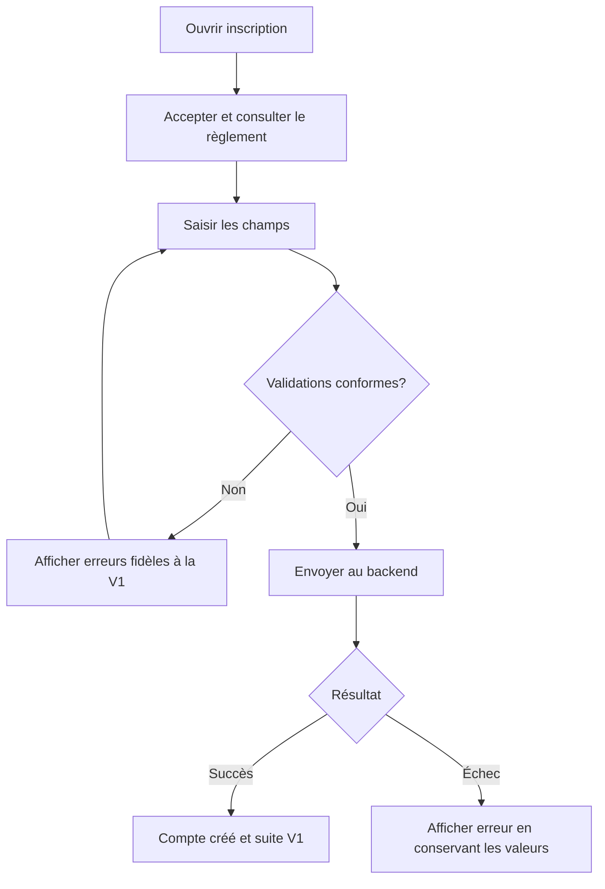

# Parcours utilisateur

Les parcours décrivent les frontières à préserver. Détails des pages, libellés, validations et états à relever dans le snapshot V1 avant les cartes de parité.

| ID | Déclencheur | Acteur | Résultat | Échecs/reprise | Stories |
| --- | --- | --- | --- | --- | --- |
| FLOW-01 | Arrivée sur le site | visiteur | contenus publics fidèles | lien/contenu/langue | US-01 |
| FLOW-02 | Inscription puis connexion | membre | compte et session selon la V1 | validation, refus, réseau, révocation | US-02 |
| FLOW-03 | Visite ou activité suivie | Viewer | points et progression crédités une seule fois | doublon ou événement invalide | US-03, US-04 |
| FLOW-04 | Récompense ou tirage | Viewer | opération traçable et solde cohérent | concurrence, seuil, indisponibilité | US-05 |
| FLOW-05 | Opération d'administration | Admin | action permise et auditée | accès refusé, validation, erreur | US-06 |

## Inscription: flux nominal et erreurs

Les étapes exactes sont à confirmer dans le dépôt V1. Aucun compte réel ne sera créé pendant les tests; employer des réponses synthétiques isolées.
