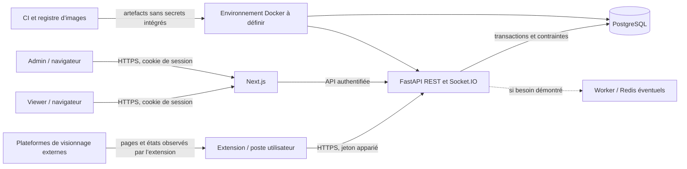

# Modèle de menace initial

**Statut :** draft de cadrage, à compléter avec le code V1, l’architecture déployée et les décisions de conception.
**Date :** 2026-11-14
**Périmètre :** application publique Skkup V2, dashboards Viewer/Admin, API, extension de navigateur, points, récompenses, boutique et tirages.

Ce document décrit les risques à traiter dans la conception et les preuves à fournir avant une mise en production. Il ne constitue ni un audit d’implémentation, ni une certification de sécurité ou de conformité.

## Décisions confirmées

- Le backend cible est FastAPI avec Pydantic; les données sont stockées dans PostgreSQL via SQLAlchemy et Alembic. Le frontend cible est Next.js avec React et TypeScript. Docker est prévu pour les environnements et services V2.
- Le dépôt V2 est public. Aucun secret, donnée personnelle, export de production ou actif de provenance inconnue ne doit donc entrer dans le dépôt, son historique, ses artefacts ou ses logs.
- Aucun fournisseur OAuth tiers n’est prévu. Les comptes et sessions suivent les parcours de la référence, à confirmer par inventaire du code et des tests V1.
- L’autorisation Viewer/Admin est appliquée par l’API. Le jeton d’extension est séparé de la session web, révocable; le code d’appairage est à usage unique, de courte durée, et un seul appareil actif est permis par compte.
- Le backend reste la source de vérité pour le temps de visionnage, les soldes, les tickets, les commandes et les droits.
- La base V2 démarre vide, sous réserve d’un inventaire préalable en lecture seule des données à conserver. Aucune migration de comptes, soldes, tickets, commandes, codes ou sessions n’est implicite.
- La boutique de tickets reste cantonnée au développement. Son activation publique attend une revue distincte du règlement et des conditions applicables; aucune conformité juridique n’est affirmée ici.
- Les secrets sont injectés à l’exécution. Le fournisseur de secrets et l’environnement de déploiement restent à choisir.
- Le propriétaire a fourni le barème de points de référence dans une image. Les critères numériques complets et leur correspondance avec les règles effectivement actives de la V1 sont gérés dans le cahier et la revue métier; ils ne sont pas reproduits ou recalculés ici.

## Hypothèses de menace

- Les pages publiques, l’API et le service de l’extension seront accessibles depuis Internet.
- Un utilisateur peut modifier les requêtes du navigateur ou de l’extension, rejouer des appels, ouvrir plusieurs sessions et soumettre des actions concurrentes.
- Les données d’un compte, les jetons, les soldes et les résultats de tirage sont isolés par utilisateur, même lorsque le client fournit des identifiants de ressource.
- Le modèle d’hébergement, les domaines, les proxys de confiance, les sauvegardes et le stockage des secrets ne sont pas encore spécifiés.
- Les plateformes de visionnage sont des sources externes non fiables. La détection d’un lecteur actif par l’extension ne prouve pas à elle seule qu’un visionnage est légitime.
- Les valeurs de récompense autres que celles explicitement confirmées et les comportements historiques doivent être vérifiés sur le commit V1 avant de devenir des règles normatives.

## Frontières de confiance

Le navigateur, l’extension, leurs données locales et les informations reçues des plateformes externes sont contrôlés par l’utilisateur et ne sont pas des sources de vérité. Les vérifications de droits, d’état et de crédit sont effectuées côté API et garanties par les transactions et contraintes de la base.

## Scénarios de menace et exigences de contrôle

| ID | Scénario | Risque initial | Contrôles requis | Preuve attendue avant production |
| --- | --- | --- | --- | --- |
| TM-01 | Un attaquant vole ou devine un mot de passe, détourne une récupération de compte ou exploite une énumération d’emails. | Élevé : prise de compte et exposition des données associées. | Hachage maintenable des mots de passe; limitation de débit; réponses non révélatrices; récupération et vérification d’email spécifiées; révocation des sessions lors des changements sensibles. | Tests négatifs d’authentification et de récupération, sans créer de compte réel; revue des limites et des réponses. |
| TM-02 | Une session web est volée ou une mutation est déclenchée depuis un site tiers. | Élevé : actions de compte au nom de la victime. | Cookie `HttpOnly`, `Secure` en production et `SameSite` défini; protections CSRF/origin; TLS; durée et révocation documentées; aucune donnée de session dans le stockage accessible au JavaScript sans justification. | Tests de session, CSRF, origine invalide, expiration et déconnexion. |
| TM-03 | Un Viewer atteint une route Admin ou lit/modifie l’objet d’un autre compte en changeant un identifiant. | Critique : contrôle des comptes, lots, tirages ou contenus. | Autorisation côté serveur sur chaque route et chaque ressource; moindre privilège; aucune décision d’accès fondée uniquement sur l’interface; audit des mutations Admin. | Matrice de tests négatifs Viewer/Admin et d’isolation entre comptes, sur REST et temps réel. |
| TM-04 | Un code d’appairage est deviné, réutilisé ou consommé après révocation; un jeton d’extension volé continue d’agir. | Élevé : session d’extension non autorisée et faux crédits. | Code aléatoire à usage unique, expiration prévue de cinq minutes, invalidation du précédent, réponse non-oracle et débit limité; jeton distinct, haute entropie, stocké haché, révocable immédiatement; unicité d’un appareil actif garantie en base. | Tests d’expiration, rejeu, brute force limité, deuxième appareil, révocation et refus immédiat du jeton révoqué. |
| TM-05 | L’extension ou le client falsifie, accélère ou rejoue un heartbeat de visionnage pour créditer des points. | Élevé : inflation de soldes et d’avantages. | Calcul et validation de durée côté serveur; contrôles de séquence, rythme, session et admissibilité; opérations idempotentes; plafonds côté serveur; transactions et ledger auditable; permissions navigateur minimales. | Tests de rejeu, payload modifié, concurrence, onglet inactif, lecteur en pause et plafond journalier. |
| TM-06 | Des requêtes concurrentes doublent le check-in, une récompense, un grattage, un débit ou l’émission d’un ticket. | Élevé : corruption des soldes et avantages. | Clés idempotentes ou contraintes uniques adaptées; transactions atomiques; verrouillage ciblé sur les ressources partagées; invariants explicités dans le modèle de données. | Tests concurrents et d’échec partiel; vérification des invariants et de l’absence de double crédit/débit. |
| TM-07 | Un Admin modifie les entrants ou les paramètres après clôture, déclenche deux tirages ou rend le résultat invérifiable. | Élevé : contestation et perte de confiance. | Snapshot immuable des tickets admissibles; graine engagée avant le tirage puis révélée; algorithme, horodatage et résultat publiés; action autorisée et auditée; transition d’état atomique et sans double tirage. | Recalcul indépendant du résultat à partir du snapshot et des éléments publiés; tests de clôture, rejeu et privilèges. |
| TM-08 | Les résultats ou listes de concours exposent un email, un identifiant interne ou un pseudonyme sans consentement. | Élevé : atteinte à la confidentialité et harcèlement. | Publier uniquement les champs nécessaires; vérifier le consentement associé au pseudonyme; séparer identifiants publics et internes; vérifier les exports, notifications et journaux. | Revue des réponses API et vues publiques; tests confirmant l’absence des champs privés. |
| TM-09 | Un Viewer achète plusieurs fois un ticket dans une course ou obtient un ticket d’un tirage fermé. | Élevé : débit indu et incohérence de commandes. | Vérifier l’état ouvert et les droits côté serveur; débiter, créer la commande et émettre le ticket atomiquement; idempotence; stock et solde protégés contre les courses. | Tests de concurrence, de retry réseau, de fermeture du tirage et de rollback. |
| TM-10 | Un contenu Admin stocke du HTML ou une URL malveillante consommée par la vitrine ou un dashboard. | Élevé : XSS stocké, hameçonnage ou prise de compte Admin. | Formats autorisés définis; rendu échappé ou assaini; validation des URLs; séparation entre brouillon et publication; accès et historique des modifications contrôlés. | Tests de payloads non fiables dans chaque contexte de rendu et revue des droits de publication. |
| TM-11 | Un WebSocket rejoint la room d’un autre utilisateur, accepte une origine non approuvée ou contourne la révocation. | Élevé : fuite inter-compte ou mutation non autorisée. | Authentifier le handshake; déterminer les rooms côté serveur; contrôler l’origine et les proxys de confiance; limiter taille et fréquence des messages; propager révocation; restaurer l’état par REST. | Tests d’isolation de rooms, origine invalide, jeton révoqué, reconnexion et messages surdimensionnés. |
| TM-12 | Une clé, un jeton, un code privé ou une donnée personnelle est exposé dans le dépôt public, un log, une image, une sauvegarde ou un artefact CI. | Critique : compromission durable ou divulgation publique. | Secrets injectés à l’exécution et absents des dépôts/images; minimisation et masquage des logs; scan des commits et artefacts; chiffrement des sauvegardes; clés de chiffrement hors dépôt, versionnées et renouvelables. | Scan des fichiers et de l’historique avant publication; examen des logs/artefacts; exercice de rotation et restauration. |
| TM-13 | Authentification, appairage, recherche, heartbeats ou WebSocket sont saturés par des requêtes automatisées. | Moyen à élevé : indisponibilité et coûts d’exploitation. | Limites de débit par compte/IP et par action; taille de requête bornée; timeouts; pagination; concurrence limitée; observation des erreurs et alertes à définir sans collecter de données superflues. | Tests de charge et de rafales ciblés; seuils et réaction documentés pour l’hébergement retenu. |
| TM-14 | Une migration, un seed, une sauvegarde ou une restauration inclut des données de production ou perd des relations entre soldes, tickets et commandes. | Élevé : perte ou divulgation de données. | Base V2 initialement vide; inventaire de conservation en lecture seule; seeds synthétiques; migrations relues et réversibles; accès DB restreint; sauvegarde et restauration testée. Aucune migration implicite. | Procédure de restauration testée sur environnement isolé; rapprochement des invariants si une migration est ultérieurement décidée. |

## Données et traitement

Les catégories attendues à confirmer dans l’inventaire V1 comprennent : email et identifiants de compte, sessions, pseudonyme et préférences, jeton d’extension, événements de visionnage, points et ledger, streaks, récompenses, tickets, achats, gagnants, contenus et traces d’administration. Les données personnelles doivent être limitées à la finalité nécessaire. Les durées de conservation, suppression, export, anonymisation, consentement de publication du pseudonyme et réponse aux incidents restent à spécifier.

La décision de base vide ne prouve pas que l’ancienne production ne contient rien à conserver. Il faut vérifier cette question sans extraire de données personnelles ou de secrets dans le dépôt. Toute migration éventuelle constitue une décision et une conception séparées.

## Décisions, hypothèses et validations restantes

### Décisions déjà prises

- Stack cible et séparation Viewer/Admin telles que listées plus haut.
- Base V2 neuve comme point de départ, après inventaire des éléments à conserver.
- Boutique limitée au développement jusqu’à une revue avant toute activation publique.
- Aucun OAuth tiers; aucun fournisseur email ou secret de production n’est configuré par ce document.
- Le tirage doit être vérifiable, la liste admissible figée et l’identité publique limitée; détails cryptographiques à arrêter dans la conception.

### Hypothèses à confirmer sur les sources V1

- Le comportement actuel de connexion, récupération, vérification d’email et révocation de sessions peut différer de la description fonctionnelle.
- Les règles de crédit quotidiennes, les récompenses de streak, les probabilités de cartes et les plateformes effectivement autorisées doivent être extraites du code, des tests et de la configuration au commit de référence.
- La compatibilité Socket.IO retenue dans le profil devra être comparée aux clients réellement publiés et à leur protocole.
- Les permissions et états précis de l’extension doivent être comparés au manifeste V1 avant de figer la liste des permissions V2.

### Vérifications requises avant livraison produit ou activation publique

1. Faire l’inventaire de la production en lecture seule et faire confirmer les données à conserver avant de créer ou basculer une base.
2. Documenter l’identité, les limites, les erreurs, la récupération de compte, l’email, la rétention et la suppression/export.
3. Définir la matrice d’autorisation par rôle, ressource, route REST et room temps réel.
4. Spécifier le ledger de points, les opérations atomiques, l’idempotence et les contraintes de concurrence.
5. Définir l’algorithme reproductible des tirages, l’engagement/révélation de graine, l’horodatage, les droits Admin et les modalités de contestation.
6. Vérifier les paramètres de déploiement, origines autorisées, proxys de confiance, TLS, gestion/rotation des secrets, logs, alertes, sauvegardes et restauration.
7. Obtenir la revue distincte du règlement et des conditions avant d’activer publiquement l’échange points/tickets.
8. Rejouer les tests de sécurité négatifs et de concurrence prévus dans le cahier sur les services effectivement construits; ce document ne prouve pas leur exécution.

## Risque résiduel

Le risque de conception reste élevé tant que les contrôles de l’API et de l’extension V1 n’ont pas été comparés, que les parcours de récupération et le cycle de vie des données ne sont pas arrêtés, que la production n’a pas fait l’objet de l’inventaire demandé, et que le protocole de tirage n’est pas entièrement spécifié. La boutique ne doit pas être présentée comme prête à l’activation publique avant sa revue dédiée.

## Références de conception

- Cahier Skkup V2 : sections 5.2 à 5.11, 6.1 à 6.3, 7 à 10 et décisions D-01 à D-13.
- Profil projet : stack FastAPI/Pydantic, SQLAlchemy 2, PostgreSQL, Alembic, Next.js/React/TypeScript, Docker, sessions et autorisations, dépôt public et environnement de déploiement non défini.
- Références V1 indiquées dans le cahier : `docs/05-security.md`, `docs/10-legal-compliance.md`, contrats API, modèles Prisma, modules Auth, Extension, Watch Sessions, Shop et Raffles. Ces sources n’ont pas été auditées dans ce lot.
